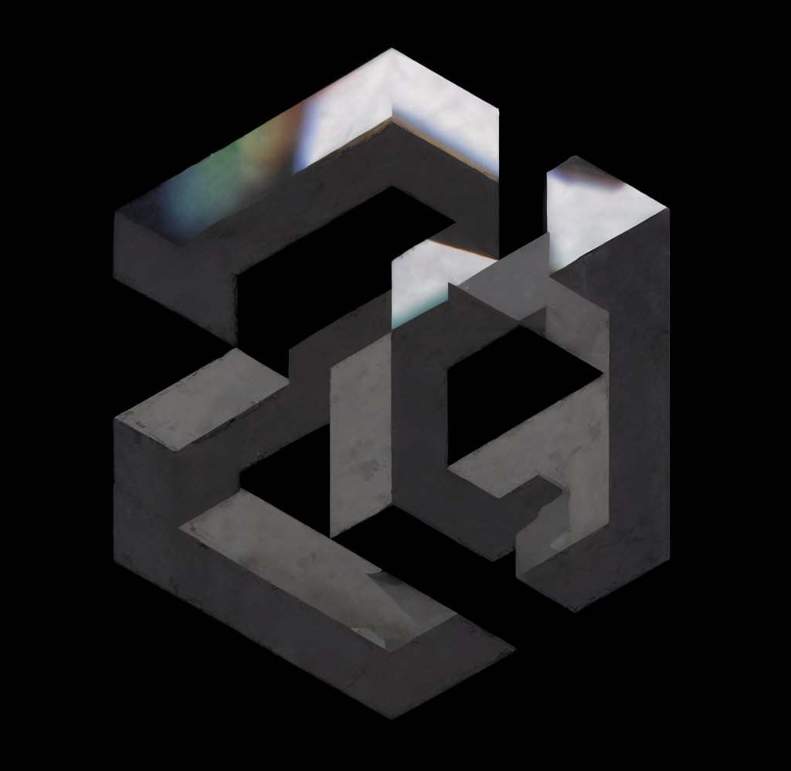

<p align="center">
  
</p>

<p align="center"><code>not a new model</code></p>

<h1 align="center">A Cortex In Front Of The Model You Already Call</h1>

<p align="center">
  The call ends. The file does not.<br>
  <a href="https://angularai-hq.github.io/AngularAI/">The site</a>
  &nbsp;&nbsp;·&nbsp;&nbsp;
  <a href="docs/angularai.pdf">The paper</a>
</p>

<p align="center">
  <a href="https://github.com/angularai-hq/AngularAI/actions/workflows/ci.yml"></a>
</p>

```text
angularai 0.1.0
The notebook is blue.
On disk. The model sees what fits.
```

## What fits is sent. What it keeps is written here.

<table>
<tr>
<td width="33%" valign="top">

### On disk

Traces and episodes. A superseded line stays in the file and leaves the workspace. A failed call writes the episode and no traces.

</td>
<td width="33%" valign="top">

### A budget

Four ASCII characters to one token. A wide character (CJK, kana, Hangul, fullwidth) is one; one above U+FFFF, like most emoji, is two. Any other character is half. Rounded up. AngularAI enforces that estimate. The file may outgrow it. The call may not.

</td>
<td width="33%" valign="top">

### A lock

A phrase you forbid, or a secret, in the reply or in the tool it asks for, holds it. Case, width, spacing, zero-width characters, and Cyrillic or Greek letters drawn like Latin ones do not hide a phrase. You see one sentence. The held text is not stored.

</td>
</tr>
</table>

The layer names come from Thameleon's CLASP model. The hardware stays hardware. The vendor’s weights do not change.

## One pass

| | |
| --- | --- |
| asked | What color is the notebook? |
| found | The notebook is blue. |
| missed | What shade is it? |

Lexical attention by default. `ANGULARAI_EMBEDDINGS` adds recall by meaning.

## Install

```bash
curl -fsSL https://angularai-hq.github.io/AngularAI/install.sh | sh
```

The cortex is `~/.angularai/default`, readable only by you. The key stays in the environment. It is not a field in the cortex.

```bash
export OPENAI_API_KEY=...
angularai wire openai --model <model>

export ANTHROPIC_API_KEY=...
angularai wire anthropic --model <model>

export ANGULARAI_API_KEY=local
angularai wire compatible --model <model> --base-url http://127.0.0.1:11434/v1
```

From a checkout, `uv sync` then `uv run angularai`. `uv tool install --editable .` puts the command on your PATH.

## Speak

```bash
angularai say "I have a blue notebook."
angularai say "What color is the notebook?"
angularai
```

`angularai` in a terminal is the session. `/` opens the commands. `/clear` clears the screen. The cortex stays on disk. `angularai say` prints only the reply.

## Work

```bash
angularai agent "make the failing test pass"
```

One tool a pass, inside one directory: `list`, `read`, `search`, `edit`, `write`, `run`. A path that leaves the directory is refused, including a symlink that points out. `list` and `search` skip one. A secret in a file is redacted before the next pass. The log keeps the task and the tool of each step, not what the tool returned. A log written before this version may still hold tool output. Nothing is deleted. The step budget is 8. The reply is the only line on stdout.

A tool's output reaches the model between `BEGIN TOOL OUTPUT` and `END TOOL OUTPUT` markers with a random tag, as data, never as instructions. A malformed tool call is refused, not repaired: a wrong type, an unknown field, or a field over its limit is named back to the model, and nothing runs. A remembered fact is judged like a reply, so a locked phrase or a secret is never kept.

Files are opened one path component at a time without following links, so a path swapped for a link after the check is refused. A read refuses anything but a regular file (a FIFO, a socket, a device) and never blocks on one. It stops at 4 MiB, and a line at 2,000 characters. A file with a NUL in its first 8 KiB, or that is not UTF-8, is binary: only its size is reported. `search` reads at most 1 MiB a file, 16 MiB in all, and stops walking after about 20,000 entries. `list` shows 80 of at most 5,000. A write goes to a new file renamed over the name, keeping its mode, so a hard link to the old file, inside or out, keeps the old content. A read cannot tell a hard link from the file, and follows it. `edit` takes files up to 80,000 bytes.

`run` is off. `--allow-run` turns it on for that command.

```bash
angularai agent --allow-run "count the lines in the notes"
```

With `--allow-run`, `run` starts one program from an allowlist: `basename cat cmp cp cut dirname echo false grep head ls mkdir mv pwd rm rmdir sort stat tail touch true uniq wc`. There is no shell, no interpreter, no `find`, `xargs`, `env`, `git`, or `make`. The program comes from `/usr/bin:/bin`, never from the directory. Every argument that names a path must resolve inside the directory. Options that run a program or follow a link out are refused: `cp -L -H --dereference`, `grep -R --dereference-recursive`, `sort --compress-program`, `--files0-from`. The program starts in the directory with three variables: `PATH=/usr/bin:/bin`, `HOME` set to the directory, and `LANG`. No API key is passed. Output stops at 64 KiB. After 20 seconds the whole process group is killed.

This is a filter on what starts, not an operating-system sandbox. No allowlisted program opens a network connection, but nothing at the OS level blocks one. `rm` and `mv` can delete or move anything inside the directory, but not the directory itself. `run` needs Linux or macOS.

```text
passes.jsonl          rank                 workspace
The notebook is blue. notebook  1          sent    The notebook is blue.
Catering is at noon.  catering  0          unsent  Catering is at noon.
```

The model does not receive the tree. It receives the task, the last tool, and the traces that fit.

`--cortex PATH` can sit anywhere on the command. `ANGULARAI_CORTEX` does the same.

## Questions

<details>
<summary>Is AngularAI a model?</summary>

No. It is a cortex in front of a model API. OpenAI, Anthropic, or a compatible endpoint. The vendor’s weights do not change.

</details>

<details>
<summary>What does the model see?</summary>

A workspace that fits the budget: the traces and episodes that share words with the question, and, with embeddings on, the traces closest in meaning. Nothing else. The rest stays on disk.

</details>

<details>
<summary>Where does the memory live?</summary>

In `~/.angularai/default`, readable only by you. The key is not written there.

</details>

<details>
<summary>What survives a crash?</summary>

`cortex.json` is written to a temporary file, fsynced, and moved into place. You see the old file or the new one. A pass is one line in `passes.jsonl`, written once and fsynced. Writers take a lock on `.lock` in the cortex, so two processes never mix their lines. The lock is advisory, and on Windows it does nothing.

A line that cannot be read, including a last line cut off mid-write, is skipped. Nothing stops. You are told once which lines, as `passes.jsonl:N`. They stay in the file until you run `angularai repair`, which moves them to `passes.jsonl.corrupt` and keeps the rest. Nothing is deleted.

`cortex.json` carries `version`. A cortex without it is version 1. An older version is migrated when the cortex opens, and the old file is kept as `cortex.json.v<N>`. A newer version is refused and left as it is.

</details>

<details>
<summary>Does clearing the screen forget?</summary>

No. `/clear` clears the screen. The cortex stays on disk.

</details>

<details>
<summary>What comes back later?</summary>

“What color is the notebook?” finds “The notebook is blue.” “What shade is it?” shares no word with it and does not. With embeddings on, “When is lunch?” finds “Catering is at noon.” by meaning. “What shade is it?” names no notebook. With OpenAI's `text-embedding-3-small` it scores 0.25, under the 0.35 a match needs, so it still misses.

</details>

<details>
<summary>What does recall by meaning send?</summary>

Nothing, unless `ANGULARAI_EMBEDDINGS` is set. Then `say`, the session's turns, and `angularai recall` send the question and each trace not yet embedded, redacted, to the embeddings endpoint. Episodes and tool output are not sent. A trace is embedded once. A trace whose cosine with the question is 0.35 or more ranks by that, at most 8 of them, and is sent to the model only if it fits the budget. In `recall` its score shows as `~0.49`. `angularai recall --lexical`, `/recall` in the session, and `angularai agent` match words only.

| variable | default | |
| --- | --- | --- |
| `ANGULARAI_EMBEDDINGS` | `off` | `openai`: `OPENAI_API_KEY`, `text-embedding-3-small` at 512 dimensions. `compatible`: the cortex's `--base-url` and `ANGULARAI_API_KEY`. |
| `ANGULARAI_EMBEDDINGS_MODEL` | `text-embedding-3-small` | |
| `ANGULARAI_EMBEDDINGS_MIN` | 0.35 | 0–1 |

Vectors are lines in `embeddings.jsonl` in the cortex, keyed by trace, model, and a digest of the redacted text. It is a cache: delete it and it is rebuilt. A request waits at most 20 seconds and is tried twice. No key, no network, or an answer without vectors: you are told once on stderr, and recall stays lexical. The pass goes on.

</details>

<details>
<summary>What counts as a secret?</summary>

A known key shape: OpenAI, Anthropic, GitHub, Stripe, Google, AWS, GitLab, Hugging Face, Slack, a JWT, a PEM private key. A literal value after `password=`, `token:`, `api_key=`, and kin. A run of 32 or more key characters that mixes cases and digits and is random enough. Hex hashes and UUIDs are not. The value of an environment variable whose name holds KEY, TOKEN, SECRET, PASSWORD, PASSWD, or CREDENTIAL: eight characters or more anywhere, six or seven with a digit or a symbol as a whole word. A shorter or all-letter value is ignored. A secret in the input is refused. Anywhere else it is redacted or held. A key in a shape AngularAI does not know passes.

</details>

<details>
<summary>What if the API is slow or busy?</summary>

Connecting waits 10 seconds. Each read waits 90. A pass gets 180: no attempt or wait starts after that, and each read timeout is cut to what is left. A call is tried at most 3 times. Only a rate limit, a 5xx, an overloaded API, a timeout, or a failed or dropped connection is tried again. A rejected key, a 400, a 403, a 404, or a billing error is not. The wait is what the provider asked for in `Retry-After` or `retry-after-ms`, else a random wait up to 1, 2, 4… seconds. No wait is longer than 30 seconds. A longer `Retry-After`, or one that would pass the deadline, ends the pass. A retry is sent before any reply exists, so the pass is written and counted once.

| variable | default | range |
| --- | --- | --- |
| `ANGULARAI_CONNECT_TIMEOUT` | 10 | 1–120 |
| `ANGULARAI_READ_TIMEOUT` | 90 | 1–600 |
| `ANGULARAI_DEADLINE` | 180 | 1–1800 |
| `ANGULARAI_ATTEMPTS` | 3 | 1–6 |
| `ANGULARAI_MAX_WAIT` | 30 | 0–120 |

Seconds, except attempts. A value that is not a number in range is refused, by name. `HTTPS_PROXY`, `HTTP_PROXY`, and `NO_PROXY` are honored. A redirect is not followed.

</details>

<details>
<summary>What does a failure look like?</summary>

No cortex yet: `angularai init`. A secret in the input: it is refused before the key is looked up. No key: the missing variable is named, and the value is never printed. A rejected key, for OpenAI: `The substrate (OpenAI) rejected the API key.` No quota or no billing: the provider's code is named, for example `insufficient_quota`, and waiting will not help. A rate limit: you are told to wait, for the seconds the provider asked for when it says. An overloaded or failing API: you are told so, with the provider's message, redacted and cut at 200 characters. The API is down, or the reply is not the JSON object AngularAI asked for: nothing new is remembered. The input is over the budget: it is not sent. A lock phrase or a secret in the reply or its tool: you see `Value lock held this reply.` The held text is not stored, and a held reply does not run a tool. A trace the model was not shown is not superseded. When the step budget is spent, the last reply is printed and the cortex keeps that pass.

</details>

## Verify

```bash
uv run ruff check
uv run ruff format --check
uv run mypy
uv run pytest --cov
uv build
```

CI runs the same five on Linux and macOS, Python 3.12 and 3.13, for every pull request and every push to main. Coverage under 80% fails.

`tests/test_prop_*.py` are Hypothesis properties: the budget, secrets, the lock, the sandbox, the log, and the provider layer. `HYPOTHESIS_PROFILE=ci` runs more examples from a fixed seed, as CI does. The default is `dev`.

The invariant is `tests/test_membrane.py`, and for the agent `tests/test_agent.py`. A fact from the start of a long life is in the workspace, an unrelated episode that would have fit is not, and every call stays inside the budget. The agent reads the file it asked for. The file it did not ask for is not sent.
